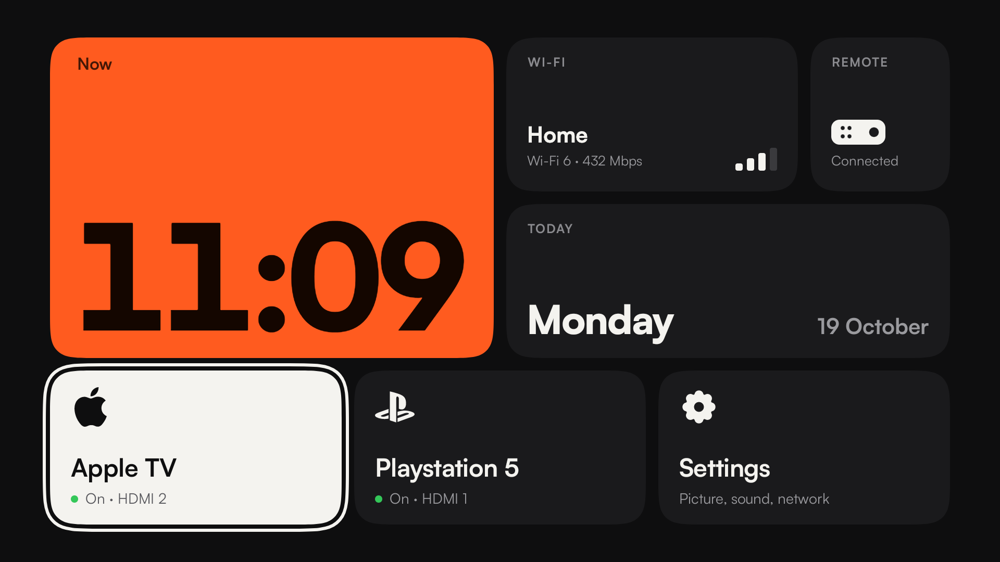
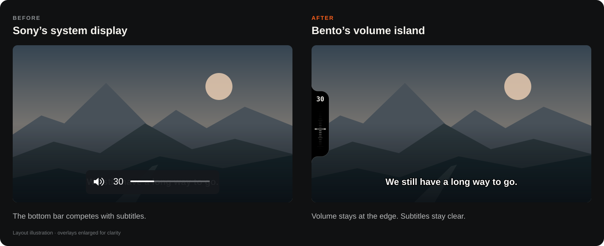

# Sony Bento

A quieter Sony BRAVIA: a simple Home screen and a volume dial that leaves your subtitles alone. Built for an Apple TV and PlayStation setup.

## A Home screen for your devices

Open Apple TV, PlayStation or another named HDMI input from one uncluttered grid. Tiles keep their position and show the real input status. Wi-Fi and remote settings are one click away; the clock and date stay out of the D-pad path.

No ads, recommendations or content rows.

## Volume at the edge

*Layout illustration; overlays enlarged for clarity.*

The optional volume island replaces Sony’s bottom display with a small dial on the left. The outline stays steady while the ticks and number move together. Muting leaves a small orange indicator.

- **Both remotes work:** Sony remote and Apple TV over HDMI-CEC.
- **Runs on the TV:** reconnects automatically after setup, with no computer needed during use.
- **No root:** uses a locally authorized helper; no bootloader unlock or firmware patch.

## Get started

Tested on **Sony K-65S30 / BRAVIA BF1, Android TV 12**. Other models and firmware versions need testing.

| Guide | What’s inside |
| --- | --- |
| [Build, install and recovery](docs/setup.md) | Requirements, installation, HDMI wake behavior and volume-helper limits |
| [Debloat and restore](debloat/README.md) | The exact package list, settings changed and how to undo them |
| [Fonts](launcher/assets/fonts/README.md) | Satoshi setup and the included IBM Plex Mono font |

**Volume setup is currently manual.** Installing the APK alone doesn’t enable the island: it needs an authorized ADB key in private app storage, debugging and the accessibility service enabled. There is no first-run pairing flow yet. See the [setup requirements](docs/setup.md#setup-requirements-and-limits). Recovery can briefly restart SystemUI; repeated failures pause the island.

## Credits

- [Satoshi](https://www.fontshare.com/fonts/satoshi) by Indian Type Foundry (ITF Free Font License, not included).
- [IBM Plex Mono](https://github.com/IBM/plex) by IBM, for the volume dial's number (SIL Open Font License, included).
- Settings and remote icons: [Tabler Icons](https://tabler.io/icons) (MIT, by Paweł Kuna).
- Apple and PlayStation logos: [Simple Icons](https://simpleicons.org) (CC0). The logos are trademarks of Apple Inc. and Sony Interactive Entertainment.
- This project is not affiliated with Sony, Google, Apple or MediaTek.

## License

The code is under the [MIT License](LICENSE). Fonts and logos keep their own licences (see Credits).
