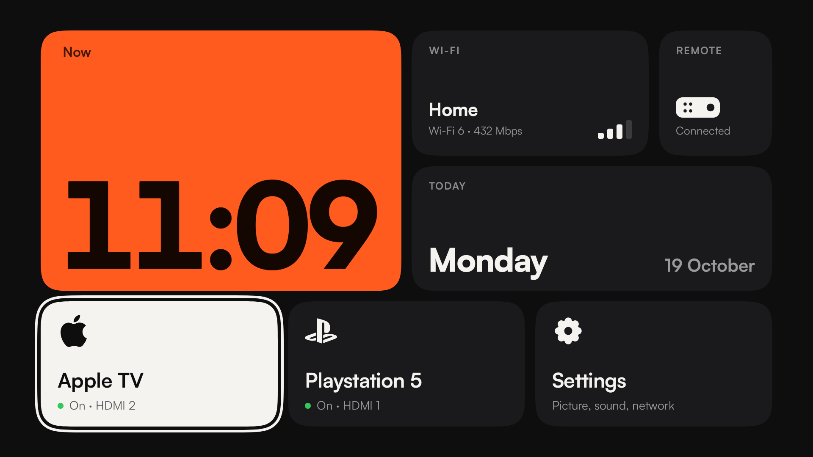

# Sony Bento

A small, ad-free Home screen for a Sony BRAVIA Google TV that is only used as a screen for an Apple TV and a PlayStation.



The stock Google TV home is full of ads and content rows. This launcher replaces it with one bento grid: a clock, the Wi-Fi and remote status, today's date, and a tile for each HDMI device. A debloat script removes Sony and Google ads, trackers and apps that this setup does not use.

Tested on a BRAVIA BF1 (Android TV 12, API 31) with an Apple TV on HDMI 2 and a PS5 on HDMI 1.

## What the launcher does

- **Inputs:** one tile for each HDMI input that has a name in the TV settings. The tile shows the real input state from `TvInputManager`: On (live signal), Standby, or Not connected. Apple TV and PlayStation get their logos.
- **Fixed order:** a tile keeps its position after you first see it, so the layout never jumps.
- **Focus:** Home opens with the focus on the input you used last.
- **Wi-Fi tile:** network name, signal bars, Wi-Fi standard and link speed. Select it to open the Wi-Fi settings.
- **Remote tile:** shows if the Bluetooth remote is connected. Select it to open the remote settings.
- **Clock and date:** display only, so they are skipped by the D-pad.
- **Corners:** iOS-style continuous corners (squircles), drawn with the Figma corner-smoothing method in [`SmoothCorners.java`](launcher/src/com/sonybento/launcher/SmoothCorners.java).

### Two fixes for Sony firmware bugs

**Black screen after the Apple TV wakes the TV.** After a long standby, the Apple TV wakes the TV over HDMI-CEC, but the screen stays black. The MediaTek TV agent asks the TV player to tune to the CEC device input (`HDMI200008`), and the TV player ignores that request when it comes from behind the Home app. The launcher listens for Sony's `com.sony.dtv.intent.action.ONE_TOUCH_PLAY` broadcast. When it arrives while Home is in front, the launcher opens the HDMI hardware input for that port itself (`TvContract.buildChannelUriForPassthroughInput`), and the picture comes back.

**Power cut.** After a power cut, the TV boots to Home and not to the last input. On the first start after a boot (`Settings.Global.BOOT_COUNT`), within 3 minutes of boot, the launcher opens the last used input as soon as the HDMI inputs register.

## Build and install

You need the Android SDK (build-tools 36.1.0 and platform `android-36`), a JDK 17 or newer, and adb access to the TV. To get it, open Settings > System > About, select "Android TV OS build" 7 times, then turn on USB debugging in Developer options. On my TV, adb then also listens on the network at port 5555.

1. Download [Satoshi](https://www.fontshare.com/fonts/satoshi) and copy `Satoshi-Regular.ttf`, `Satoshi-Bold.ttf` and `Satoshi-Black.ttf` into `launcher/assets/fonts/`. The font licence does not allow the files in this repository.
2. Build: `./launcher/build.sh`. The APK is signed with your Android debug key and written to `launcher/build/sony-bento.apk`.
3. Install and grant the permissions. Android only shows the Wi-Fi name to apps with location access, and the remote status needs Bluetooth access.

   ```bash
   adb connect <tv-ip>:5555
   adb install -r launcher/build/sony-bento.apk
   adb shell pm grant com.sonybento.launcher android.permission.ACCESS_FINE_LOCATION
   adb shell pm grant com.sonybento.launcher android.permission.BLUETOOTH_CONNECT
   ```

4. Give each HDMI input a name in the TV settings (for example "Apple TV"). Inputs without a name do not get a tile.
5. Run the debloat script below. It also makes Sony Bento the Home app.

## Debloat

[`debloat/debloat.sh`](debloat/debloat.sh) removes apps for user 0 with `pm uninstall -k --user 0`. The original APKs stay on the read-only system partition, so nothing is deleted for good. No root is needed.

```bash
BRAVIA_IP=<tv-ip> ./debloat/debloat.sh            # debloat and set Sony Bento as Home
BRAVIA_IP=<tv-ip> ./debloat/debloat.sh restore    # put everything back
```

A factory reset also restores everything. A Sony firmware update can bring some apps back. If that happens, run the script again.

### Removed (33 packages)

**Ads, promos and trackers**

| Package | What it is |
|---|---|
| `tv.samba.ssm` | Samba TV. Recognises what is on screen for ad targeting. |
| `com.sony.dtv.promos` | "My BRAVIA" promo content |
| `com.sony.dtv.sonyselect` | Sony Select, the promoted apps row |
| `com.sony.dtv.notificationcenter` | BRAVIA notifications (promo pop-ups) |
| `com.sony.dtv.sonytab` | Sony content tab |
| `com.sony.dtv.interactivetvutil` | Uploads Sony usage, viewing and voice logs |
| `com.google.android.feedback` | Play Store feedback agent |
| `com.google.android.play.games` | Play Games |
| `com.google.android.videos` | Google Play Movies |
| `com.google.android.youtube.tvmusic` | YouTube Music |

**Apps this setup does not use**

| Package | What it is |
|---|---|
| `com.sony.dtv.multiscreendemo` | Store demo mode |
| `com.sony.dtv.smarthelp`, `com.sony.dtv.helpguidecontents` | Built-in help (99 MB) |
| `com.sony.dtv.voicesearch` | Sony voice search |
| `com.sony.dtv.ecodashboard` | Eco dashboard |
| `com.sony.dtv.sktvfb`, `com.sony.dtv.operatorapputil.service` | Channel editor and cable operator apps |
| `com.mediatek.tv.oneworld.logdump`, `com.mediatek.tv.oneworld.logdumpservice`, `com.mediatek.tv.diagnosis` | MediaTek debug log tools |
| `com.mediatek.wwtv.mediaplayer` | USB media player |
| `com.sony.dtv.all4launcher`, `com.sony.dtv.iplayerlauncher`, `com.sony.dtv.itvlauncher`, `com.sony.dtv.my5launcher`, `com.sony.dtv.soundslauncher`, `com.youview.poa` | UK TV app shortcuts |
| `com.amazon.amazonvideo.livingroom`, `com.netflix.ninja`, `com.netflix.tokenmanager` | Prime Video and Netflix (watched on the Apple TV instead) |
| `com.google.android.apps.tv.dreamx` | Google Ambient Mode, the screensaver with suggestions |
| `com.google.android.katniss` | Google Assistant and voice. This also removes the always-on mic permission. |
| `com.google.android.syncadapters.calendar` | Google Calendar sync |

### Disabled (3 packages)

These are disabled with `pm disable-user --user 0`, not removed:

| Package | Why disabled and not removed |
|---|---|
| `com.google.android.apps.tv.launcherx` | The Google TV home. If it stays on, it takes Home back after its 30-second boot timeout. |
| `com.google.android.tungsten.setupwraith` | Google setup. Its recovery screen claims Home with a higher priority. |
| `com.sonypicturescore` | Sony Pictures Core store. Sony's device control service crashes if this app is removed fully. |

### Settings changed

- Home app: `cmd package set-home-activity com.sonybento.launcher/.MainActivity`
- Screensaver off (it pointed at the removed Ambient Mode).

### Do not remove

These broke the TV when I removed them. Sony's system service and the MediaTek TV agent read their content providers at boot, and the TV crash-looped after a cold boot:

- `com.sony.dtv.m2.seeds.iot`, `com.sony.dtv.m2.seeds.auth`
- `com.sony.dtv.demosupport`, `com.sony.dtv.demosystemsupport`

Also leave these alone, because they run HDMI, CEC and the TV itself:

- `com.mediatek.tv.oneworld.tvcenter` (the player that shows HDMI)
- `com.mediatek.tis` (HDMI inputs)
- `com.mediatek.tv.agent` (CEC One Touch Play)
- `com.mediatek.dtv.tvinput.framework.server`
- `com.sony.dtv.sonysystemservice`
- `com.sony.dtv.connecteddevicesettings` (CEC settings)
- Google Play services

I also uninstalled 9 apps that I had installed myself. They are not part of the script.

## Credits

- [Satoshi](https://www.fontshare.com/fonts/satoshi) by Indian Type Foundry (ITF Free Font License, not included).
- Settings and remote icons: [Tabler Icons](https://tabler.io/icons) (MIT, by Paweł Kuna).
- Apple and PlayStation logos: [Simple Icons](https://simpleicons.org) (CC0). The logos are trademarks of Apple Inc. and Sony Interactive Entertainment.
- This project is not affiliated with Sony, Google, Apple or MediaTek.

## License

The code is under the [MIT License](LICENSE). Fonts and logos keep their own licences (see Credits).
